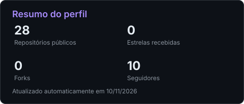
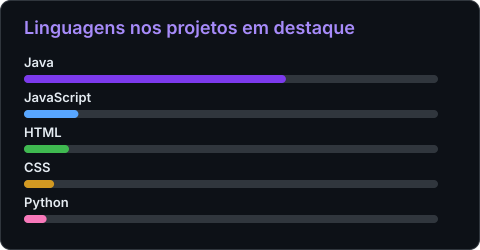

```text
                                                                                  ⠀⠀⠀⠀⠀⠀⠀⠀⡀⡠⣄
                                                                                  ⠀⠀⠀⠀⠀⠀⡠⣖⢀⡬⡕⠖⢢
                                                                                  ⠀⠀⠀⠀⠀⣌⡎⠣⡸⢙⡜⡘⡄⢧
  .oooooo..o                                                   oooo               ⠀⠀⠀⠀⢠⢸⢀⣠⠤⡄⡇⠱⠸⠸⠄
 d8P'    `Y8                                                   `888               ⠀⠀⠀⠀⡄⣿⢸⠁⢀⡇⠁⡆⢇⠄⠦
 Y88bo.       .oooo.   ooo. .oo.  .oo.   oooo  oooo   .ooooo.   888               ⠀⠀⠀⠐⡁⡧⠸⢤⡋⡴⠩⡇⢸⢀⢸⡀
  `"Y8888o.  `P  )88b  `888P"Y88bP"Y88b  `888  `888  d88' `88b  888               ⠀⠀⠀⡌⢀⡇⠗⢺⠧⢆⡐⢹⠄⠆⠓⠰⠄
      `"Y88b  .oP"888   888   888   888   888   888  888ooo888  888               ⠀⠀⢁⢡⠏⡇⢵⠚⠆⠀⢆⠘⡈⢱⣏⡇⠅
 oo     .d8P d8(  888   888   888   888   888   888  888    .o  888               ⠀⠀⠀⢊⠚⡇⢸⡑⠥⠄⠘⢠⠥⢢⠑⡉
 8""88888P'  `Y888""8o o888o o888o o888o  `V88V"V8P' `Y8bod8P' o888o              ⠀⠀⠀⢨⡸⡙⠈⢷⠉⠁⢀⠾⠀⡟⠐⡠
                                                                                  ⠀⠀⠀⠀⠝⣸⣰⠈⢦⠔⡁⡜⠴⡁⡱
                                                                                  ⠀⠀⠀⠀⠀⢃⢱⠃⢦⡐⢠⢻⠰⠧
                                                                                  ⠀⠀⠀⠀⠀⢨⠸⠌⠀⠈⡇⣟⠸⠁
                                                                                  ⠀⠀⠀⠀⠀⠀⠐⠀⠀⠘⠃⠛

 .-----------------------------------------------------------------------------.
 | (x) (-) (+)                    ~/about-me.txt                               |
 |-----------------------------------------------------------------------------|
 |                                                                             |
 | I'm Samuel Santos Miranda, a software developer and data analyst.           |
 | I turn data and ideas into useful solutions.                                |
 |                                                                             |
 | I work with Java, Spring Boot, Python, SQL, and BI.                         |
 | I have a degree in Systems Analysis and Development from UniCarioca.        |
 | -@SamuelSantos20                                                            |
 |                                                                             |
 '-----------------------------------------------------------------------------'
```

<p></p>

<p>
  
</p>

<p></p>

<p>
  <a href="https://www.linkedin.com/in/samuel-santos20/"></a
  ><a href="https://www.instagram.com/_samusm_/"></a
  ><a href="https://github.com/SamuelSantos20"></a
  ><a href="mailto:samuelfamilia377@gmail.com"></a>
</p>

## Experience

<table>
  <tr>
    <td width="100" align="center">
      
    </td>
    <td>
      <strong>Data Analyst Intern</strong><br />
      <a href="https://www.marinha.mil.br/">Brazilian Navy</a> • May 2026 — present<br /><br />
      I support analysis and decision-making in the Cost Management Department. My work includes processing JSON, CSV, and Excel data; building dashboards and reports with Power BI and Metabase; and cleaning, organizing, and integrating datasets with Python, Pandas, and SQL.
    </td>
  </tr>
  <tr>
    <td width="100" align="center">
      
    </td>
    <td>
      <strong>Data and Software Intern</strong><br />
      <a href="https://www.gov.br/inss/pt-br">INSS</a> • Mar 2024 — Mar 2026<br /><br />
      I helped develop and maintain internal solutions, analyzed existing systems, supported digital tools, and assisted the public. I also helped diagnose and adjust data and communication networks.
    </td>
  </tr>
  <tr>
    <td width="100" align="center">
      
    </td>
    <td>
      <strong>3rd place — ROBLOX Jam for Change</strong><br />
      <a href="https://www.iea.usp.br/">USP Institute for Advanced Studies</a> • Mar–Apr 2026<br /><br />
      My team developed the educational game <strong>Reignite</strong>. I programmed its mechanics in Lua using Roblox Studio. The project placed 3rd, received certification from IEA-USP, Roblox, and Games for Change Latin America, and won a US$500 prize.
    </td>
  </tr>
</table>

## Featured projects

| Project | Description | Technologies |
| --- | --- | --- |
| [Library API](https://github.com/SamuelSantos20/library-api) | Library management API | Java, Spring Boot |
| [Time Sheet](https://github.com/SamuelSantos20/time-sheet) | Employee time tracking API | Java, Spring Boot |
| [Finanças Municipais da Baixada](https://github.com/SamuelSantos20/financas-municipais-baixada) | Pipeline for extracting and analyzing public fiscal data from municipalities in the Baixada Fluminense region | Python, Pandas, Requests, SICONFI API |
| [Game Synopsis](https://github.com/SamuelSantos20/game_synopsis) | API for cataloging games and organizing personalized lists | Java, Spring Boot, PostgreSQL, MapStruct, Liquibase, Docker, Swagger |
| [Stock Management System](https://github.com/SamuelSantos20/Stock_Management_System) | Web-based inventory management system | Java, Spring Boot, Spring Security, MySQL, Thymeleaf |
| [Corporate Manager](https://github.com/SamuelSantos20/Corporate_Manager) | Management of roles, departments, and employees | Java, Spring Boot, Thymeleaf |

## GitHub stats

<div align="center">
  
  
</div>

<p align="center">
  <sub>Cards are stored in this repository and updated automatically by GitHub Actions.</sub>
</p>

---

```text
 SamuelSantos20@github ~ % exit
 logout
 See you next time.▌
```

